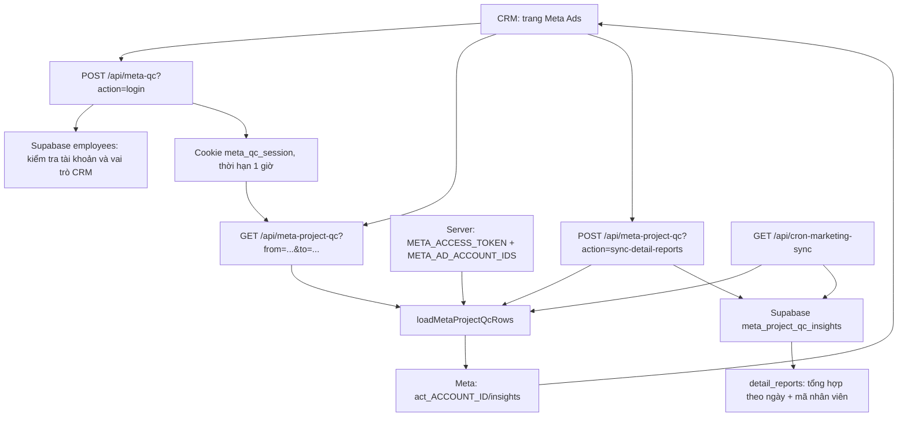

# Bàn giao kết nối Meta: đổi người quản trị, đổi token và thêm tài khoản quảng cáo

Ngày kiểm tra: **17/11/2026**, khoảng **23:22–23:24 giờ Việt Nam**.

Phạm vi: mã nguồn đang có trong workspace và gọi **đọc** Meta bằng cấu hình local. Chưa đối chiếu biến môi trường Vercel, phiên đăng nhập CRM production, migration đã áp dụng hay lần cron production chạy thành công. Đợt kiểm tra này không đổi token, cấp/thu hồi quyền, triển khai hoặc ghi dữ liệu Supabase.

## 1. Kết luận để bàn giao cho khách

Hệ thống hiện dùng **một token chung trên server** (`META_ACCESS_TOKEN`) để đọc **danh sách tài khoản quảng cáo cấu hình sẵn** (`META_AD_ACCOUNT_IDS`). Chưa có chức năng “Kết nối Facebook”, “Đổi Facebook” hay chọn tài khoản từ Meta để lưu kết nối trong CRM.

Token local hiện tại được Meta xác nhận là **SYSTEM_USER**, tên **Conversions API System User**, ID do API trả về `122148037605058928`; token hợp lệ, có `ads_read`, khớp App ID trong cấu hình local. `expires_at=0` và `data_access_expires_at=0` tại thời điểm kiểm tra: không có hạn cố định được báo về, nhưng token vẫn có thể bị thu hồi hoặc mất quyền tài sản.

Đây là tài khoản máy thuộc Business, không phải một người đang đăng nhập Facebook trên trình duyệt. Meta mô tả System User là danh tính cho server/phần mềm thao tác trên tài sản Business sở hữu hoặc quản lý. [Tài liệu System Users](https://developers.facebook.com/docs/business-management-apis/system-users/).

| Nhu cầu của khách | Cách xử lý với code hiện tại |
| --- | --- |
| Đổi người dùng Facebook quản trị cùng Business | Bàn giao quyền Business và ứng dụng cho người mới; giữ System User đang chạy nếu vẫn thuộc Business và còn đủ quyền. Kiểm tra lại API trước khi gỡ quyền người cũ. |
| Thêm tài khoản quảng cáo mà cùng System User có thể đọc | Cấp quyền tài khoản cho System User trên Meta, kiểm tra Insights, rồi bổ sung ID vào `META_AD_ACCOUNT_IDS` và triển khai lại. |
| Chuyển sang System User hoặc Business khác | Tạo token mới có quyền đọc toàn bộ tài khoản cần giữ, thử đọc trước, thay `META_ACCESS_TOKEN` trên server và triển khai lại. |
| Giữ các kết nối độc lập, mỗi khách một token | Cần phát triển thêm. Hiện không có ánh xạ tài khoản quảng cáo → token riêng. |
| Khách tự bấm kết nối/đổi Facebook ngay trong CRM | Cần tích hợp Facebook Login for Business và lưu kết nối phía server; xem mục 8. |

Ô email/mật khẩu ở trang Meta Ads là **tài khoản quản trị CRM**. Nhập một Facebook khác vào đó không đổi kết nối Meta.

## 2. Luồng API thực tế



| Điểm vào | Xác thực | Hành vi |
| --- | --- | --- |
| `GET /api/meta-project-qc?from=YYYY-MM-DD&to=YYYY-MM-DD` | Cookie CRM và header `X-Meta-QC-Request: 1` | Luồng của trang `/crm-admin/meta-ads`. Đọc tất cả ID trong env; trả dữ liệu trực tiếp, không lưu DB. Tối đa 90 ngày. |
| `POST /api/meta-project-qc?action=sync-detail-reports`, body `{ "from": "...", "to": "..." }` | Cùng phiên CRM | Gọi Meta lại, lưu snapshot rồi cập nhật các cột Meta trong `detail_reports`. |
| `GET /api/meta-qc` | Phiên CRM | Trả danh sách ID từ env. |
| `POST /api/meta-qc`, body `{ "account_id": "...", "since": "...", "until": "..." }` | Phiên CRM | Luồng QC xem trước từng tài khoản, tối đa 31 ngày; không ghi DB. |
| `GET /api/meta-ads?account_id=...&since=...&until=...` | `Authorization: Bearer <META_SYNC_SECRET>` | API server-to-server, đọc một ID đã cho phép, tối đa 31 ngày. |
| `POST /api/meta-ads` cùng query | Cùng secret | Lưu vào **`meta_ads_insights`**, không phải pipeline ghi `detail_reports`. |
| `GET /api/cron-marketing-sync` | `Authorization: Bearer <CRON_SECRET>` và môi trường được bật | Đồng bộ Meta rồi Odoo. Lịch trong `vercel.json` hiện là `*/15 * * * *`; mặc định lấy hôm nay và 3 ngày trước theo giờ Việt Nam. |
| `npm run meta:sync -- --read-only` | Biến môi trường trên máy chạy | Đọc từng tài khoản bằng `metaClient`. Bỏ `--read-only` sẽ ghi `meta_ads_insights`. |

Luồng trang Meta Ads lấy Insights cấp **campaign/ngày**, dùng tiền **VND**, tách mã nhân viên từ cặp `[...]` đầu tiên trong tên chiến dịch. Ví dụ: `[FBC.VietPT] Tên chiến dịch`. Khi lưu báo cáo, mã được đối chiếu với `employees.ma_ns`, có fallback `marketing_staff.id_ns`; thiếu mã hoặc thiếu hồ sơ có tên/email thì không lên đầy đủ báo cáo nhân viên.

Ngày Insights giữ theo múi giờ tài khoản Meta, không tự quy đổi thành ngày Việt Nam. Cần đối chiếu Ads Manager với đúng tài khoản, múi giờ và kỳ báo cáo.

## 3. Thêm tài khoản quảng cáo bằng kết nối đang có

Người thực hiện cần quyền quản trị Business/tài sản Meta và quyền sửa cấu hình, triển khai project Vercel. Chỉ có tài khoản Admin CRM chưa đủ để thực hiện toàn bộ quy trình này.

1. Trong Ads Manager, lấy **Ad Account ID** dạng số của tài khoản muốn đọc. Không dùng Facebook User ID, Business ID, Page ID hoặc mã TKQC nội bộ.
2. Mở **Business Settings / Cài đặt doanh nghiệp**, chọn đúng Business Portfolio. Nếu tài khoản thuộc Business khác, hoàn tất quyền truy cập/chia sẻ đối tác cho Business đang vận hành kết nối trước.
3. Vào **Users → System Users / Người dùng → Người dùng hệ thống**, chọn System User đang chạy, dùng **Add Assets / Thêm tài sản** và gán tài khoản quảng cáo với quyền xem hiệu quả/báo cáo phù hợp. Nếu phải chọn ứng dụng, chọn ứng dụng của kết nối đang dùng. Tên mục có thể khác theo giao diện Meta.
4. Token cần có **`ads_read`**, đồng thời System User phải được cấp quyền trên chính tài khoản đó. Chỉ thêm tài khoản vào Business hoặc thêm ID vào CRM không đủ. Meta yêu cầu `ads_read` để đọc Ads Insights. [Tài liệu Ads Insights](https://developers.facebook.com/docs/marketing-api/insights/v9.0).
5. Thử đọc tài khoản mới bằng token hiện tại trước khi thêm vào cấu hình chung. Có thể dùng Graph API Explorer với đúng app/token, kiểm tra `GET /act_<ID_MOI>?fields=account_id,name,currency,timezone_name` và `GET /act_<ID_MOI>/insights?fields=spend&date_preset=yesterday&limit=1`. `data: []` vẫn là lần đọc hợp lệ khi ngày đó không có dữ liệu. Không đưa token vào ảnh chụp hoặc tài liệu bàn giao.
6. Trong Vercel, mở project → **Environment Variables**, sửa biến **Production** `META_AD_ACCOUNT_IDS`, giữ danh sách cũ và nối thêm ID mới bằng dấu phẩy. Ví dụ minh họa:

   ```dotenv
   META_AD_ACCOUNT_IDS=111111111111111,222222222222222,333333333333333
   ```

   Dùng ID số, dấu phẩy, không dùng chấm phẩy để tương thích tất cả các luồng. Token hiện tại thường có thể dùng tiếp khi đã có scope và quyền tài sản; lấy kết quả thử Insights làm căn cứ. Không bắt buộc tạo lại token cho mỗi tài khoản thêm vào.
7. **Redeploy** để deployment mới nhận biến môi trường. Khi chạy local, sửa `.env.local` rồi khởi động lại `npm run dev`. Vercel xác nhận thay đổi env chỉ áp dụng cho deployment mới. [Quản lý biến môi trường Vercel](https://vercel.com/docs/environment-variables/managing-environment-variables).
8. Mở `/crm-admin/meta-ads`, xác nhận tài khoản Admin CRM nếu được yêu cầu, chọn một ngày có dữ liệu và bấm **Lấy từ API Meta**. Đối chiếu tài khoản, chi phí, tiền tệ và mã nhân viên. Sau khi đọc đúng mới dùng **Đồng bộ Meta → detail_reports**.
9. Nếu cần quản lý nội bộ, thêm tài khoản ở trang **Tài khoản quảng cáo** (`/crm-admin/ad-accounts`) để gắn dự án/nhân viên/team. Đây là bước quản lý riêng: form chỉ ghi bảng Supabase `tkqc` mặc định, không tự thêm ID vào env, cấp quyền Meta hoặc tạo tài khoản trên Meta.

## 4. Đổi người quản trị Facebook hoặc chuyển kết nối

### 4.1. Chỉ đổi người quản trị trong cùng Business

1. Người quản trị hiện tại cấp cho Facebook mới quyền quản trị Business và quyền ứng dụng/tài sản cần bàn giao.
2. Người mới đăng nhập và xác nhận truy cập được Business, ứng dụng, System User cùng các tài khoản quảng cáo cần dùng.
3. Giữ nguyên System User/token nếu kết nối vẫn thuộc Business đó và còn đủ quyền. Đăng xuất hoặc đổi Facebook trên trình duyệt không thay `META_ACCESS_TOKEN` đang nằm trên server.
4. Kiểm tra lại API và trách nhiệm vận hành Vercel trước khi gỡ quyền người cũ. Xác nhận riêng quyền sở hữu app, Business và project triển khai; thêm người mới không tự chuyển quyền sở hữu các tài sản này.

### 4.2. Chuyển sang System User hoặc Business khác

1. Lưu phiên bản cấu hình hiện tại trong nơi quản lý bí mật của bên vận hành; chốt danh sách tài khoản cần giữ và phạm vi ngày phải bảo toàn số liệu. Không ghi token vào Git/tài liệu.
2. Ở Business đích, chuẩn bị ứng dụng Meta và System User phù hợp. Gán ứng dụng và các tài khoản quảng cáo được phép truy cập; tạo token có `ads_read`. Điều kiện gán app, Business và System User được Meta mô tả trong [hướng dẫn tạo System User](https://developers.facebook.com/docs/business-management-apis/system-users/create-retrieve-update) và [hướng dẫn tạo token](https://developers.facebook.com/docs/business-management-apis/system-users/install-apps-and-generate-tokens).
3. Kiểm tra token bằng **Access Token Debugger** của Meta: đúng ứng dụng, còn hợp lệ, có `ads_read`. Tiếp tục thử Insights của **mọi tài khoản sẽ nằm trong danh sách**. Token hợp lệ không đồng nghĩa được đọc tất cả tài khoản. Nếu Meta yêu cầu token có hạn, bàn giao cả mốc gia hạn; không giả định token mới luôn là token không hết hạn.
4. Thay **`META_ACCESS_TOKEN`** ở môi trường Vercel Production. Cập nhật `META_AD_ACCOUNT_IDS` nếu tập tài khoản thực sự thay đổi; xem mục 5 trước khi bỏ ID cũ.
5. Redeploy, kiểm tra đọc trên CRM, rồi kiểm tra đồng bộ và cron. Một token mới muốn giữ tài khoản cũ phải có quyền trên cả tài khoản cũ lẫn mới.
6. Chỉ thu hồi token/quyền cũ sau khi kết nối mới đã được xác minh. Nếu cần quay lại, khôi phục env cũ và redeploy; thao tác này **không tự khôi phục dữ liệu DB** đã bị thay thế bởi một lần đồng bộ.

**Biến cần phân biệt:**

| Biến | Ý nghĩa trong code hiện tại |
| --- | --- |
| `META_ACCESS_TOKEN` | Chứng thực với Meta. Đây là biến quyết định danh tính/quyền đọc của kết nối. |
| `META_AD_ACCOUNT_IDS` | Danh sách tài khoản API được phép/được yêu cầu đọc. |
| `META_API_VERSION` | Phiên bản Graph API, hiện cấu hình local `v26.0`; đã gọi thành công trong đợt kiểm tra. |
| `META_SYNC_SECRET` | Secret nội bộ cho `/api/meta-ads` và ký cookie Meta QC; không phải token Facebook. Không cần thay chỉ vì đổi kết nối Meta. |
| `SUPABASE_URL` hoặc `VITE_SUPABASE_URL`, `SUPABASE_SERVICE_ROLE_KEY` | Kết nối DB phía server, dùng xác thực CRM và lưu đồng bộ. |
| `CRON_SECRET` | Xác thực cron marketing; độc lập với token Facebook. Local kiểm tra hiện thiếu biến này; chưa kết luận cấu hình production. |
| `META_APP_ID`, `META_APP_SECRET` | Có trong env local nhưng luồng đọc/đồng bộ Meta đang kiểm tra **không dùng chúng** để đổi hoặc tự gia hạn token. Nếu đổi ứng dụng, cập nhật thông tin bàn giao tương ứng; chỉ sửa App ID không làm đổi kết nối API. |

Giữ token, App Secret và service role key ở server, không đặt tiền tố `VITE_` cho các bí mật này.

## 5. Ảnh hưởng dữ liệu cần xử lý trước khi bỏ tài khoản cũ

**Pipeline `meta-project-qc` thay snapshot của toàn bộ khoảng ngày**, không thay riêng từng tài khoản: RPC `replace_meta_project_qc_insights` xóa các dòng có `report_date` trong kỳ rồi chèn lại tập vừa lấy. `sync_meta_qc_to_detail_reports` có thể đặt số Meta cũ về 0 cho các ngày đã đối chiếu đầy đủ trước khi ghi tổng mới.

Ví dụ: trước đây đọc A+B; đổi env chỉ còn C rồi đồng bộ lại 01–03/11. Snapshot A+B trong ba ngày đó bị thay bằng C; báo cáo Meta theo nhân viên có thể mất phần A+B hoặc trở về 0. Dữ liệu ngoài kỳ được chọn không bị thao tác này thay thế. Các cột Odoo/doanh số không bị RPC Meta cập nhật.

- Khi **thêm** tài khoản, giữ ID cũ và bảo đảm token đọc được toàn bộ danh sách.
- Khi **bỏ/chuyển** tài khoản nhưng cần giữ lịch sử, xác định ngày chuyển và sao lưu snapshot/báo cáo của kỳ có thể bị chạy lại. Cron mặc định chạy lại cả 3 ngày trước nên không chỉ ảnh hưởng ngày hiện tại.
- Nếu cần tự động giữ lịch sử A+B và cộng thêm C khi token mới không còn đọc được A+B, cần sửa chiến lược lưu theo tài khoản và ngày hiệu lực trước khi chuyển. Code hiện tại chưa có cơ chế đó.
- Từ PR #5 (18/11/2026), một tài khoản bị từ chối quyền (Meta code 10/200) **không còn làm hỏng** lần đọc của trang Meta Ads. Loader bỏ qua tài khoản đó, trả danh sách trong `failedAccounts`, và trang hiện cảnh báo vàng. Tuy nhiên, bước **đồng bộ `detail_reports` và cron sẽ từ chối chạy** (`meta_accounts_incomplete`) cho tới khi mọi tài khoản đọc được, để không ghi đè làm mất snapshot của tài khoản lỗi. Vì vậy vẫn phải thử quyền tài khoản mới trước khi đưa vào danh sách chung: `node scripts/checkMetaAccounts.mjs .env <ID_MOI>`. Hướng dẫn từng bước: [huong-dan-them-tai-khoan-quang-cao-meta.pdf](huong-dan-them-tai-khoan-quang-cao-meta.pdf).

Không dùng các endpoint ghi để thử token. Bắt đầu bằng GET hoặc CLI có `--read-only`.

## 6. Kiểm tra sau khi đổi/thêm

| Kiểm tra | Điều kiện đạt |
| --- | --- |
| Token | Meta Debugger báo hợp lệ, đúng app và scope; có ghi nhận thời hạn nếu áp dụng. |
| Tài khoản | Mọi ID cấu hình đều đọc được metadata và Insights bằng token đích. |
| Đọc trên deployment mới | Trang Meta Ads tải được kỳ thử; số tài khoản và dữ liệu đúng. Phép đọc local không thay cho bước này. |
| Tiền tệ/múi giờ | Pipeline VND không bỏ sót tài khoản khác tiền; ngày đối chiếu theo múi giờ từng tài khoản. |
| Nhân viên | Tên campaign chứa `[Mã NV]`; mã khớp hồ sơ có tên/email, kiểm tra các cảnh báo mã chưa khớp. |
| Ghi báo cáo | Sau khi đã duyệt số liệu đọc, đồng bộ và kiểm tra `sourceRowsSaved`, `detailRowsSynced`, `unmatchedEmployeeCodes`, `rowsWithoutEmployeeCode`, `datesNotReset`, `skippedCurrencies`; đối chiếu snapshot và `detail_reports.meta_synced_at`. |
| Cron | Kiểm tra một lần production chạy có xác thực, HTTP 200 và `status: ok`; không có lỗi nguồn Meta/Odoo. Có lịch trong file chưa chứng minh cron đã chạy. |

Lệnh kiểm tra đọc của CLI có sẵn, chạy trên máy đã có dependency đúng nền tảng và env được cấu hình:

```bash
# Thay ID minh họa bằng tài khoản đã có trong META_AD_ACCOUNT_IDS.
npm run meta:sync -- --read-only --account 111111111111111 --since 2026-11-16 --until 2026-11-16
```

CLI này kiểm tra luồng `metaClient` cấp ad; nó không ghi báo cáo, không kiểm tra đăng nhập CRM và không thay cho việc thử trang Meta Ads cấp campaign.

| Lỗi | Cần kiểm tra |
| --- | --- |
| `session_required`, `invalid_credentials`, `crm_auth_failed`, `forbidden` | Phiên/quyền đăng nhập CRM, kết nối `employees`; đây chưa phải bằng chứng token Meta lỗi. |
| `meta_token_invalid` hoặc `meta_auth_failed`, Meta code 190 | Trạng thái token, thu hồi, thời hạn. Thông báo hiện tại nói kiểm tra “tự động xoay vòng”, nhưng code đang có không làm việc đó. |
| `meta_permission_denied`, Meta code 10/200 | Scope và quyền tài sản của System User trên tài khoản cụ thể. |
| `account_not_allowed` | ID chưa có trong danh sách env của deployment đang chạy. |
| `meta_not_configured`, `meta_config_invalid`, `invalid_meta_config` | Token, ID, phiên bản và định dạng env. |
| Timeout/rate limit | Thử kỳ ngắn, kiểm tra số tài khoản và log; các function Meta/cron hiện có `maxDuration: 60`. |

## 7. Bằng chứng kiểm tra ngày 17/11/2026

- Gọi `/me` và `/debug_token` của Meta bằng env local: xác nhận System User ở mục 1; không xuất giá trị token/App Secret.
- **18/18 ID local** đọc thành công metadata và một trang Insights mẫu cho **16/11/2026**. Tất cả metadata trả về tiền VND. Lần thử một trang nhằm kiểm tra quyền, không dùng để tính tổng.
- Chạy trực tiếp **`loadMetaProjectQcRows` đang dùng trong sản phẩm**, đầy đủ phân trang cho cùng ngày: **37 dòng**, không thiếu mã nhân viên, không bỏ tiền tệ. Cụ thể: `1667694257419578` (FBC - A6) 16 dòng, `795287166904506` (FBC - A7) 1 dòng, `872604782404058` (FBC - A8) 20 dòng; 15 tài khoản còn lại trả rỗng cho kỳ này.
- Có múi giờ khác Việt Nam: `719932067032734` → `Etc/GMT-9`; `1667694257419578` → `Asia/Manila`; `795287166904506` và `872604782404058` → `Etc/GMT-8`. Không cộng ngày các nguồn theo giả định tất cả đều GMT+7.
- **19/19 test Meta hiện có đạt**. Thêm kiểm tra mô phỏng tại thời điểm audit xác nhận dùng token chung, lọc VND/tách mã và hành vi lỗi một tài khoản làm lần đọc tổng thất bại. Các test npm hiện chưa bao phủ đầy đủ pipeline project QC/cron/DB.
- `npm run test:meta` ban đầu bị chặn do `node_modules` chứa esbuild Windows trong khi máy chạy Linux. Đợt audit dùng binary Linux cùng phiên bản `0.28.2` trong thư mục tạm qua `ESBUILD_BINARY_PATH` để chạy test; không sửa dependency/lockfile của repo. Khi bàn giao máy khác cần cài dependency theo nền tảng máy đó.
- Kết quả local đọc thật không chứng minh env Vercel giống local, quyền CRM production đúng, DB đã được migration, hay cron đã ghi báo cáo thành công.

## 8. Nếu yêu cầu là khách tự đổi/thêm ngay trên CRM

Đây là phần cần triển khai thêm. Luồng đề xuất:

1. Admin khách bấm **Kết nối Meta / Đổi kết nối** và qua **Facebook Login for Business**, cấp quyền cho các tài sản muốn đọc.
2. Backend kiểm tra phiên CRM, OAuth state/callback và đổi authorization code; xác nhận app, danh tính, scope, tài khoản được cấp.
3. Lưu kết nối/token mã hóa phía server theo khách/đơn vị và danh sách tài khoản được phép; frontend chỉ nhận tên, ID, trạng thái và thời hạn cần thiết.
4. Cho phép chọn/thêm tài khoản trong phạm vi đã cấp quyền, thử Insights trước khi kích hoạt. Các tài khoản cần thêm quyền phải qua bước cấp lại trên Meta.
5. Sửa loader và cron lấy token theo kết nối, xử lý lỗi riêng từng tài khoản, lưu snapshot theo khách/tài khoản/ngày và giữ lịch sử theo ngày hiệu lực. Gỡ phụ thuộc vào một `META_ACCESS_TOKEN` và một danh sách env toàn hệ thống.
6. Có thao tác kết nối lại/ngắt kết nối, trạng thái lỗi quyền và quy trình bảo toàn dữ liệu khi thay kết nối.

Meta mô tả Facebook Login for Business là luồng cấu hình loại token, quyền và tài sản để khách cấp quyền; có Business Integration System User token phù hợp tác vụ tự động lấy Ads Insights. Phục vụ Business không do mình sở hữu/quản lý cần Advanced Access qua App Review theo yêu cầu áp dụng. Đây là hướng phát triển, chưa có trong repository hiện tại. [Tài liệu Facebook Login for Business](https://developers.facebook.com/documentation/facebook-login/facebook-login-for-business).

## 9. Vị trí mã nguồn để người nhận tiếp quản

| File | Vai trò |
| --- | --- |
| [MetaAdsView.tsx](../src/pages/dashboard/admin/MetaAdsView.tsx) | Trang lấy dữ liệu và nút đồng bộ. |
| [metaProjectQcHandler.ts](../server/metaProjectQcHandler.ts) | Xác thực CRM, GET đọc, POST ghi. |
| [metaTokenManager.ts](../server/metaTokenManager.ts) | Chỉ đọc `env.META_ACCESS_TOKEN`; không có vault/rotation trong phiên bản hiện tại. |
| [metaProjectQc.ts](../server/metaProjectQc.ts) | Danh sách env, gọi Insights, phân trang, VND, mã nhân viên. |
| [metaQcHandler.ts](../server/metaQcHandler.ts) | Login CRM, cookie 1 giờ, danh sách tài khoản và QC xem trước. |
| [metaClient.ts](../server/metaClient.ts), [metaHandler.ts](../server/metaHandler.ts), [metaSync.ts](../server/metaSync.ts) | Luồng riêng `/api/meta-ads` và CLI, bảng `meta_ads_insights`. |
| [metaDetailReportSync.ts](../server/metaDetailReportSync.ts) | Snapshot và ghép báo cáo theo ngày/mã nhân viên. |
| [migration Meta/Odoo](../supabase/migrations/20261015000000_meta_odoo_detail_report_sync.sql), [SQL tương ứng](../supabase/create_meta_detail_report_sync.sql) | Schema, RPC thay snapshot theo khoảng ngày và upsert báo cáo. |
| [marketingDetailReportCron.ts](../server/marketingDetailReportCron.ts), [vercel.json](../vercel.json) | Secret, kỳ chạy lại và lịch cron. |
| [AdAccountFormModal.tsx](../src/pages/dashboard/admin/AdAccountFormModal.tsx) | Chỉ quản lý TKQC trong Supabase. |
| [.env.example](../.env.example) | Tên biến môi trường; không phải bằng chứng cấu hình production. |

`CODEX_WORK_REPORT.md` có mô tả scaffold rotation từ các phiên trước; khi vận hành cần ưu tiên mã hiện tại: `metaTokenManager.ts` chỉ đọc env, không có route xoay token. `docs/meta-ads.md` chủ yếu mô tả luồng QC/`meta-ads` riêng, không thay cho các lưu ý thay snapshot của pipeline `meta-project-qc` trong tài liệu này.
